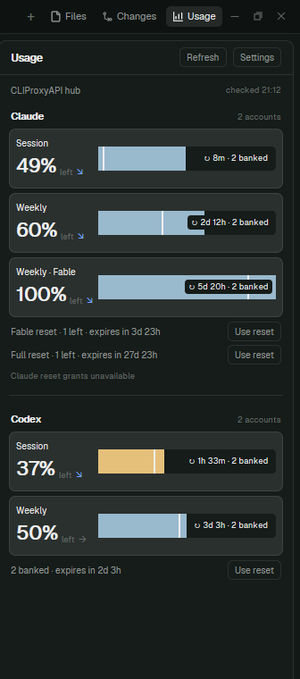
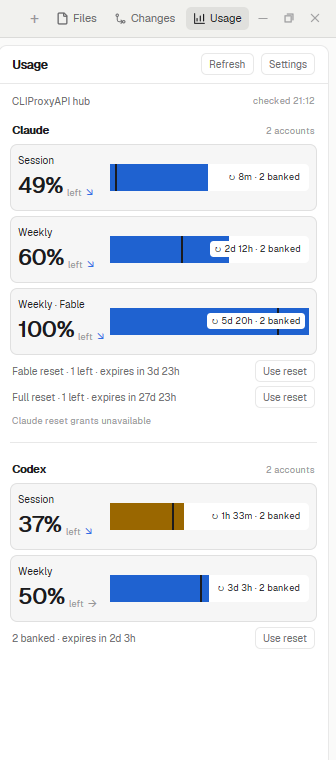

# herdr-core-cliproxy

A **herdr-app mod** for monitoring [CLIProxyAPI](https://github.com/router-for-me/CLIProxyAPI) subscription quota without leaving your workspace. Inspired by t3code's **Usage → Limits** view.

Despite the repository name, this runs in **herdr-app**, not as a herdr-core plugin. Developed against herdr-app **0.1.16** and herdr-core **0.1.21**.

| Dark (Graphite) | Light (Paper) |
| --- | --- |
|  |  |

*Screenshots use local stub data, not real accounts.*

## Features

- **Claude and Codex gauges:** Session, Weekly, and model-scoped Claude windows such as **Weekly · Fable**, when reported by the hub.
- **Usage tab beside Files and Changes:** opens and closes the existing side panel, before the window controls—not a separate column beyond the close button. The panel choice is remembered per space.
- **Ollama Cloud via plugin:** included/purchased credit balances, 24-hour spend and token counts, billing-period quota or legacy session/weekly gauges. Read-only; no Ollama key is stored in this mod.
- **Alibaba Token Plan via plugin:** 5-hour, weekly and monthly credit-remaining gauges with reset countdowns, from the [Token Plan Usage plugin](https://github.com/AngDrew/cliproxyapi-tokenplan-usage) `tokenplan-usage` monitor (needs a console cookie on the hub). Read-only.
- **Clean subscription sections:** a divider separates Claude and Codex; no redundant email, plan, percentage, or miniature quota rows beneath the gauges.
- **Native panel styling:** the same rounded border, clipped corners, 42px header, and header divider as Files/Changes.
- **Theme-aware colors:** follows herdr-app's light, dark, and custom themes; no fixed provider colors or white-only markers.
- **Pace indicators:** a contrasting tick marks the even-spending target; hover over the arrow for an explanation.
- **Manual resets:** see banked Codex credits and Claude reset grants, including Fable/full resets when available, with remaining count and expiry.
- **Confirmation before spending:** **Use reset** identifies the account and asks before redeeming anything.
- **Automatic refresh every 15 minutes**, plus a **Refresh** button. Countdown text is calculated when the panel repaints, not by a second-by-second timer.

### Reading the pace indicator

Bars and percentages show quota **left**, not quota used.

| Indicator | Meaning |
| --- | --- |
| ↗ Ahead of pace | Spending faster than the window elapses; less quota remains than the even-spending target. |
| → On pace | Within **5 percentage points** of the even-spending target. |
| ↘ Behind pace | Spending slower than the window elapses; more quota remains than the target. |
| — Unavailable | The hub did not report a reset time, so pace cannot be calculated. |

The target is the percentage of time remaining in the window. For example, halfway through a window, the even-spending target is **50% quota left**.

## Appearance

Usage automatically follows the theme selected in herdr-app; there is no separate mod theme to configure. Normal quota bars use the theme's **accent** color, low quota (16–40% left) uses **working**, and critical quota (15% or less) uses **blocked**. Quota rows are a slim 8px bar with the percentage, label and reset countdown beneath it; the pace marker straddles the bar in the theme's **working** color, switching to **foreground** when the fill is already at working level, so it never disappears into the bar.

Borders, cards, buttons, hover states, labels, and status messages use the same native theme tokens as the rest of herdr-app. Checked visually with Graphite, Paper, and Atom One Dark, including the existing panel's 280px minimum width.

## Requirements

- herdr-app with its bundled `confirm` mod.
- A CLIProxyAPI hub URL and **management key**.
- Hub support for `v0/management/auth-files` and `v0/management/api-call`; `v0/management/reset-quota` clears hub routing cooldowns after a successful reset.
- Accounts that report quota through the upstream Claude or Codex APIs. Reset availability depends on the account and provider, not just the mod.
- For Ollama: [cliproxyapi-ollama-usage](https://github.com/AngDrew/cliproxyapi-ollama-usage) installed on the hub, its quota-only `ollama-usage` monitor auth file, and `POST /v0/management/quota/fetch` support. Your existing OpenAI-compatible Ollama provider alone does not create a quota card.

## Install

### 1. Copy the mod

Clone this repository and copy the contents of `cliproxy-usage/` into `~/.config/herdr-app/mods/cliproxy-usage/`.

**PowerShell:**

```powershell
git clone https://github.com/AngDrew/herdr-core-cliproxy.git
cd herdr-core-cliproxy
$mod = Join-Path $HOME '.config/herdr-app/mods/cliproxy-usage'
New-Item -ItemType Directory -Force -Path $mod | Out-Null
Copy-Item ./cliproxy-usage/* -Destination $mod -Force
```

For updates, run `git pull` in the clone and repeat the copy command. The repository does not contain `config.json`, so copying its mod files does not overwrite your saved credentials.

### 2. Add Usage to the existing panel stack

Back up `~/.config/herdr-app/layouts/main.json`. Find the stack with `"id": "panel-body"` inside the existing `panel` column, and append this object to **that stack's `children` array**, alongside `files` and `changes`:

```json
{
  "id": "usage",
  "type": "block",
  "content": { "mod": "cliproxy-usage" }
}
```

Keep the existing Files and Changes entries and the panel's width settings. **If upgrading from the original standalone layout, remove the old root-level `usage` column** so there is only one Usage view. Do not add a new outer column: that places the content beyond the titlebar's window controls.

### 3. Add the titlebar button

The bundled Tabs mod currently names its panel buttons explicitly. Back up `~/.config/herdr-app/mods/tabs/main.js`, then apply the small [Tabs patch](integration/tabs.patch) from the repository root:

```powershell
$patch = Join-Path $PWD 'integration/tabs.patch'
$appHome = Join-Path $HOME '.config/herdr-app'
git -C $appHome apply --check --ignore-space-change $patch
if ($LASTEXITCODE -ne 0) { throw 'Patch did not match; check whether it is already applied or your Tabs mod differs.' }
git -C $appHome apply --ignore-space-change $patch
```

The patch adds **Usage** after **Changes**, using the same open/close and per-space panel state. It preserves your Files/Changes choices and only enables Usage when the layout contains the `usage` child. Its icon is included in the mod folder copied in step 1.

This patch targets the bundled Tabs mod from herdr-app 0.1.16. If an app update replaces that mod, check whether the patch needs to be reapplied; do not overwrite newer Tabs code with an old copy.

### 4. Connect your hub

Click the **Usage** tab, then **Set up**, enter the hub URL and management key, and **Save**. A URL ending in `management.html` is accepted. The optional label replaces the hub hostname in the header.

Use **Settings** to change the connection later. No keyboard binding is required or installed.

## Ollama Cloud

Install the [Ollama Usage plugin](https://github.com/AngDrew/cliproxyapi-ollama-usage#install) on CLIProxyAPI and add its monitor credential. Leave your existing Ollama inference provider unchanged, then update this mod and click **Refresh**. The hub handles Ollama authentication server-side; the mod uses only its existing management key.

The same monitor appears in CLIProxyAPI **Quota Management → Plugin**. This panel reads its normalized quota response and displays included balance, period allowance, purchased balance, 24-hour spend/requests/tokens and available quota gauges. USD values below $1 retain five decimal places. Multiple monitors show separate money rows rather than summing potentially shared balances.

The billing gauge is included balance divided by the period allowance; it is not 24-hour usage divided by the allowance. Monthly pace is unavailable without an actual window length, so no misleading seven-day pace tick is drawn. Legacy 5-hour/weekly plans retain their ordinary pace indicators.

Ollama monitoring cannot spend reset credits. Missing/invalid plugin responses and HTTP failures show an error rather than a fabricated full-quota gauge. Ollama usage may lag and covers the provider's usage scope across clients, not just traffic through this hub. The hub plugin caches for one minute; this panel keeps its existing 15-minute automatic refresh.

## Manual resets

### Codex

The panel counts available, unexpired `codex_rate_limits` credits and shows the earliest expiry. **Use reset** spends the earliest-expiring credit after confirmation. A deterministic request ID makes retries of that same credit idempotent.

### Claude

Claude uses a separate **`cedar_ember` reset-grant API**, following the [CLIProxyAPI management UI](https://github.com/router-for-me/Cli-Proxy-API-Management-Center/blob/main/src/services/api/claudeResetGrants.ts). Each grant shows its label, remaining resets, and expiry. The mod checks fresh eligibility, usability, expiry, cooldown, and limit requirements before submitting a claim.

An unavailable grant has no active spend button; hover **Unavailable** for the reason. Missing grant data is shown as **Claude reset grants unavailable**, rather than silently implying the account has no resets.

The CLI user-agent matters: an older or different surface can make Anthropic report `ineligible: surface` even for an account with grants. The mod uses the CLI header required by the management UI.

### Safety and ambiguous outcomes

- Polling and tests never redeem credits. A real redemption requires confirmation.
- A successful redemption is followed by a hub cooldown-clear request. If that fails, the panel warns that the reset succeeded but routing may remain blocked temporarily.
- Each Claude attempt is journaled locally in **`reset-operation.json`** before submission. If the response is ambiguous or times out, the mod **does not automatically retry**, and further Claude claims stay blocked across reloads.
- If that happens, check the provider/hub to establish whether the reset was spent. Only then clear or delete the local journal. This is deliberately a single Claude-operation lock across accounts, not a background retry system.

## Credentials and privacy

The management key is masked in Settings and stored in the installed mod's **`config.json`**. Treat that file as a secret; it is local plaintext, not an encrypted credential vault. herdr-app mods are trusted code.

`config.json`, `reset-operation.json`, and generated editor/type files are gitignored. Never publish your config, management key, account tokens, or screenshots containing private account information. The hub substitutes account tokens for the literal `Bearer $TOKEN$`; the mod does not need to extract them.

## Development

Use a Node.js version with built-in `fetch` (Node 18+). From the repository root:

```sh
node dev/hub.test.js
node dev/claude-reset.test.js
node dev/panel.test.js
node dev/tab-integration.test.js
node dev/ollama.test.js
node dev/tokenplan.test.js
```

These checks use fake responses and do not contact your hub or spend real resets.

For local fixture data:

```sh
node dev/stub-hub.mjs --port 8318
```

Connect the panel to `http://127.0.0.1:8318/` with management key `stub`. The stub includes Claude grants, Codex credits, an Ollama credit-balance monitor, and accounts without credits. `--fail-reset-quota` exercises the cooldown-clear warning. Restore your real hub settings after testing.

To validate an installed mod:

```sh
herdr-app check ~/.config/herdr-app/mods/cliproxy-usage
herdr-app status
```

## Known limits

- Multiple accounts are pooled by **simple average**, not capacity-weighted quota.
- Pace assumes five-hour session and seven-day weekly windows; nonstandard plan windows may differ.
- One hub at a time; Claude, Codex and the `ollama-usage` / `tokenplan-usage` plugins only.
- This is a native GPUI panel, not a pixel-for-pixel copy of t3code's web interface.

## Uninstall

Remove the `usage` child from `panel-body`. Undo the two Tabs changes using `integration/tabs.patch` in reverse (check it still applies first), or restore your backed-up Tabs file if it has not otherwise changed. Then delete `~/.config/herdr-app/mods/cliproxy-usage/`. Deleting the folder also removes its saved credentials and local reset journal.
